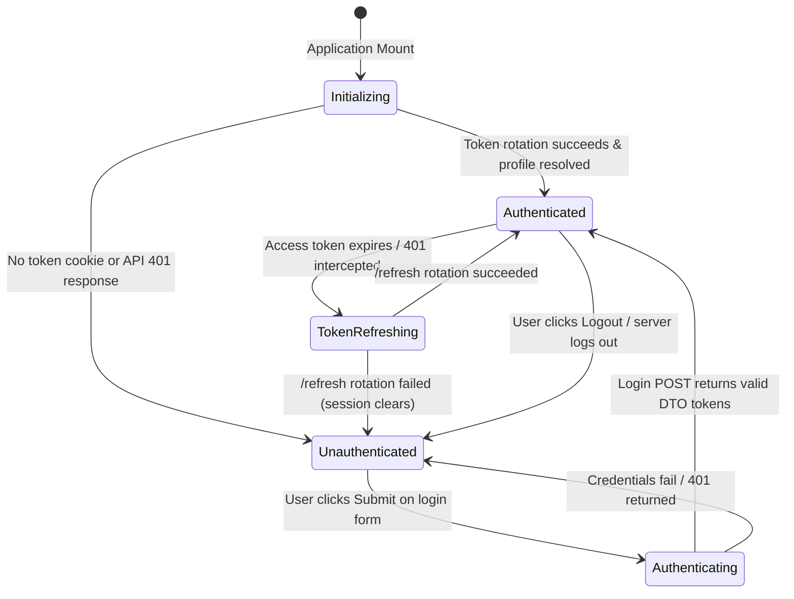

# Phase 1 Auth State Machine

This document defines the states, events, and transitions of the Svelte authentication store.

## State Mappings

- **Initializing (`isInitializing: true`)**:
    - The application is restoring the session. A loading shell / splash screen is rendered. Protected page views are blocked during this state to prevent content flashing.
- **Authenticated (`isAuthenticated: true`, `user !== null`)**:
    - The user has a valid access token. User profile properties (`name`, `email`, `userType`, `permissions`) are loaded into the store. Sidebar modules are active.
- **Unauthenticated (`isAuthenticated: false`, `user === null`)**:
    - No active tokens. The SvelteKit layout redirects the user to the `/login` page.
- **SessionError (`sessionError !== null`)**:
    - Used to flag login form failures or display diagnostic notices (such as account deactivations).
